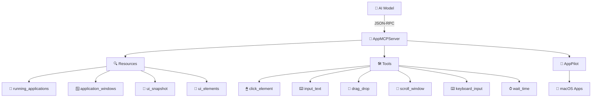

# 🤖 AppMCP

> **AI-Powered macOS Application Automation via Model Context Protocol**

[](https://swift.org)
[](https://developer.apple.com/macos/)
[](https://github.com/modelcontextprotocol/swift-sdk)
[](LICENSE)

**AppMCP** bridges the gap between AI models and macOS applications, enabling intelligent automation through visual inspection, UI interpretation, and precise control of native applications.

---

## ✨ Features

### 🎯 **Visual Intelligence**
- **Smart Screenshots**: Capture high-resolution app windows with element identification
- **UI Element Hierarchy**: Extract detailed accessibility trees with unique element IDs
- **ElementID-Based Targeting**: Capture UI state once, operate multiple times with same IDs
- **Multi-App Discovery**: Identify and monitor multiple running applications simultaneously

### 🛠 **Automation Toolkit**
- **Element-Based Operations**: Click, input text, drag & drop using element IDs
- **Keyboard Automation**: Execute keyboard shortcuts and key sequences
- **Smart Waiting**: Time-based wait operations for UI synchronization
- **Fail-Fast Design**: Explicit error propagation for reliable debugging

### 🔒 **Privacy & Security**
- **Permission Management**: Accessibility and Screen Recording permission handling
- **Secure Communication**: JSON-RPC over STDIO with structured error handling
- **Bundle ID Validation**: Verified application targeting for enhanced security

---

## 🚀 Quick Start

### Prerequisites
- **macOS 15.0+** (Sequoia or later)
- **Swift 6.1+**
- **Xcode 16.0+**

### Installation

```bash
# Clone the repository
git clone https://github.com/your-username/AppMCP.git
cd AppMCP

# Build the project
swift build -c release

# Run the daemon
./.build/release/appmcpd --stdio
```

### Permissions Setup

AppMCP requires the following macOS permissions:

1. **🔓 Accessibility**: System Preferences → Privacy & Security → Accessibility
2. **📺 Screen Recording**: System Preferences → Privacy & Security → Screen Recording

*The application will guide you through the permission setup process.*

---

## 🎮 Usage Examples

### Weather App Automation

```python
import json
import subprocess

# Start AppMCP server
process = subprocess.Popen(['./appmcpd', '--stdio'])

# Step 1: Discover running applications
request = {
    "jsonrpc": "2.0",
    "id": 1,
    "method": "resources/read",
    "params": {"uri": "appmcp://resources/running_applications"}
}
response = send_mcp_request(request)
print(f"📱 Running apps: {response['result']['contents'][0]['text']}")

# Step 2: Capture UI snapshot with screenshot and element IDs
request = {
    "jsonrpc": "2.0",
    "id": 2,
    "method": "resources/read",
    "params": {"uri": "appmcp://ui/snapshot/com.apple.weather"}
}
response = send_mcp_request(request)
snapshot = json.loads(response['result']['contents'][0]['text'])
print(f"📸 Screenshot: {snapshot['screenshot']}")
print(f"🌳 Elements: {len(snapshot['elements'])} found")

# Step 3: Use element IDs to perform actions
search_field_id = snapshot['elements'][0]['id']  # Example: first element

request = {
    "jsonrpc": "2.0",
    "id": 3,
    "method": "tools/call",
    "params": {
        "name": "click_element",
        "arguments": {"elementId": search_field_id}
    }
}

request = {
    "jsonrpc": "2.0",
    "id": 4,
    "method": "tools/call",
    "params": {
        "name": "input_text",
        "arguments": {
            "elementId": search_field_id,
            "text": "Tokyo",
            "method": "setValue"
        }
    }
}
```

### UI Element Discovery Without Screenshot

```python
# Get just the element hierarchy (faster, no screenshot)
request = {
    "jsonrpc": "2.0",
    "id": 5,
    "method": "resources/read",
    "params": {"uri": "appmcp://ui/elements/com.apple.weather"}
}

tree = send_mcp_request(request)
elements = json.loads(tree['result']['contents'][0]['text'])
print(f"🌳 Elements: {elements}")
```

---

## 🏗 Architecture



### Core Components

| Component | Description | Technology |
|-----------|-------------|------------|
| **📡 AppMCPServer** | MCP protocol server with Resources and Tools | MCP SDK v0.7.1, Swift 6.1 |
| **🚀 AppPilot** | Core macOS UI automation framework | Accessibility API, CGEvent |
| **🔍 Resources** | Read-only data sources (apps, windows, UI state) | NSWorkspace, AXUIElement |
| **🛠 Tools** | State-mutating operations (click, type, drag) | CGEvent, AXUIElement |
| **🔒 Permissions** | Accessibility and Screen Recording management | TCC Framework |

---

## 📦 Package Structure

```
AppMCP/
├── 📁 Sources/
│   └── 📁 AppMCP/
│       ├── 🎯 AppMCP.swift          # Core protocols & types
│       ├── 🖥 MCPServer.swift        # Main MCP server
│       ├── 📁 Resources/            # Data providers
│       ├── 📁 Tools/                # Automation tools
│       └── 📁 Permissions/          # Security management
├── 📁 Sources/appmcpd/
│   └── 🚀 Command.swift             # CLI daemon
├── 📁 Tests/
│   └── 📁 AppMCPTests/              # Comprehensive test suite
├── 📋 Package.swift                 # Swift Package configuration
└── 📖 CLAUDE.md                     # Development guidelines
```

---

## 🧪 Testing

### Run All Tests
```bash
swift test
```

### Test Categories
- **🔧 Unit Tests**: Core functionality validation
- **🔗 Integration Tests**: End-to-end workflow testing
- **⚡ Performance Tests**: Response time benchmarking
- **🛡 Security Tests**: Permission and validation checks

### Example Test Results
```
Test Suite 'AppMCPTests' passed at 2025-06-04 16:42:04.049
    Executed 19 tests, with 0 failures (0 unexpected) in 0.015 seconds
✅ All tests passing
```

---

## 🛠 API Reference

### MCP Resources (Read-Only Data)

AppMCP provides 4 resources for querying macOS UI state:

#### `running_applications`
**URI**: `appmcp://resources/running_applications`

List all running applications with metadata:
- Application name
- Bundle ID
- Process ID
- Active/inactive status

#### `application_windows`
**URI**: `appmcp://resources/application_windows`

List windows for all applications with:
- Window title
- Bounds (x, y, width, height)
- Visibility status
- Z-order information

#### `ui_snapshot`
**URI**: `appmcp://ui/snapshot/{bundleID}`

Capture UI state with screenshot and element IDs:
- **Screenshot**: Base64-encoded PNG image
- **Elements**: Array of UI elements with unique IDs, roles, titles, bounds
- **Use case**: AI visual analysis + programmatic access

#### `ui_elements`
**URI**: `appmcp://ui/elements/{bundleID}`

Get element hierarchy without screenshot (faster):
- Element ID, role, title, bounds
- Accessibility hierarchy
- **Use case**: Quick element discovery without visual capture

---

### MCP Tools (State-Mutating Actions)

AppMCP provides 6 specialized tools for macOS automation:

#### `click_element`
Click UI elements using element ID:
- **Parameters**: `elementId`, `button` (left/right/center), `clickCount`
- **Returns**: Success message with clicked element info

#### `input_text`
Input text into UI elements:
- **Parameters**: `elementId`, `text`, `method` (type/setValue)
- **Returns**: Success message with input confirmation

#### `drag_drop`
Drag and drop between elements:
- **Parameters**: `fromElementId`, `toElementId`, `duration`
- **Returns**: Success message with drag operation info

#### `scroll_window`
Scroll at element location:
- **Parameters**: `elementId`, `deltaX`, `deltaY`
- **Returns**: Success message with scroll info

#### `keyboard_input`
Execute keyboard shortcuts and sequences:
- **Parameters**: `keys`, `modifiers` (command/option/control/shift)
- **Returns**: Success message with executed keys

#### `wait_time`
Time-based wait operation:
- **Parameters**: `duration` (seconds, max 60.0)
- **Returns**: Success message after waiting

---

## 🎯 Roadmap

### 🌟 Current (v1.0)
- [x] Resource-based UI inspection (apps, windows, snapshots)
- [x] ElementID-based automation workflow
- [x] 6 specialized MCP tools (click, input, drag, scroll, keyboard, wait)
- [x] AppPilot integration for core automation
- [x] Fail-fast error handling

### 🚀 Near Future (v1.1)
- [ ] Multi-app simultaneous control
- [ ] Window management operations
- [ ] Enhanced element search with criteria
- [ ] Performance optimizations

### 🔮 Long Term (v2.0)
- [ ] HTTP transport support
- [ ] Shortcuts.app integration
- [ ] Plugin SDK for extensions
- [ ] Real-time UI streaming

---

## 🤝 Contributing

We welcome contributions! Please see our [Contributing Guidelines](CONTRIBUTING.md) for details.

### Development Setup
```bash
# Install dependencies
swift package resolve

# Run tests
swift test

# Format code
swift-format -i -r Sources/ Tests/

# Build for development
swift build
```

---

## 📄 License

AppMCP is released under the **MIT License**. See [LICENSE](LICENSE) for details.

---

## 🙏 Acknowledgments

- **[Model Context Protocol](https://github.com/modelcontextprotocol/swift-sdk)** - For the excellent MCP Swift SDK
- **Apple Developer Team** - For the powerful macOS automation APIs
- **Swift Community** - For the robust Swift ecosystem

---

<div align="center">

**Built with ❤️ for the AI automation community**

[📖 Documentation](docs/) • [🐛 Issues](https://github.com/your-username/AppMCP/issues) • [💬 Discussions](https://github.com/your-username/AppMCP/discussions)

</div>